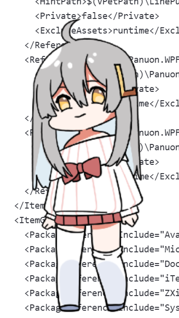
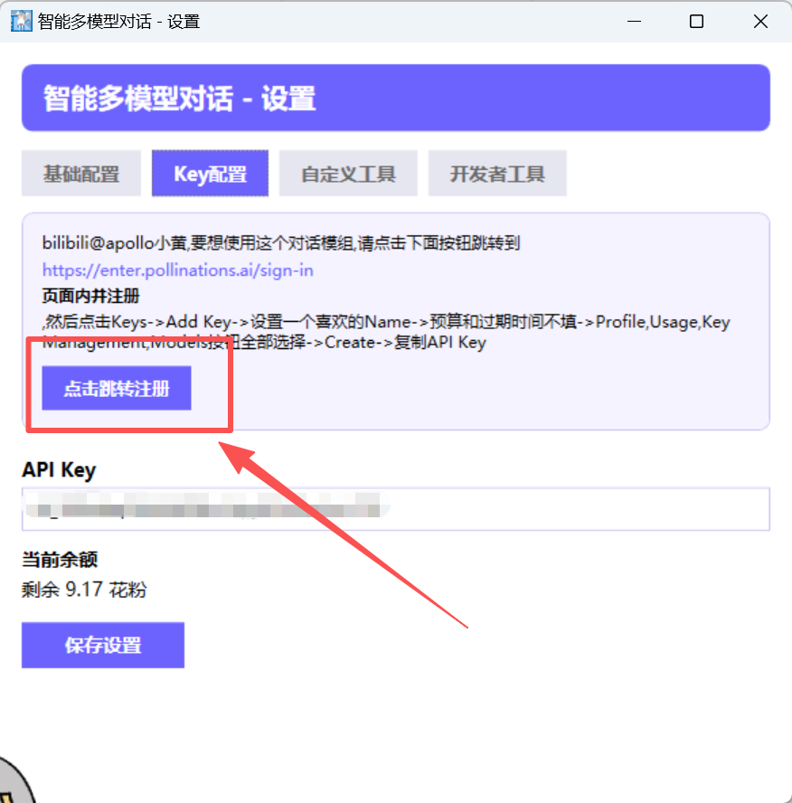
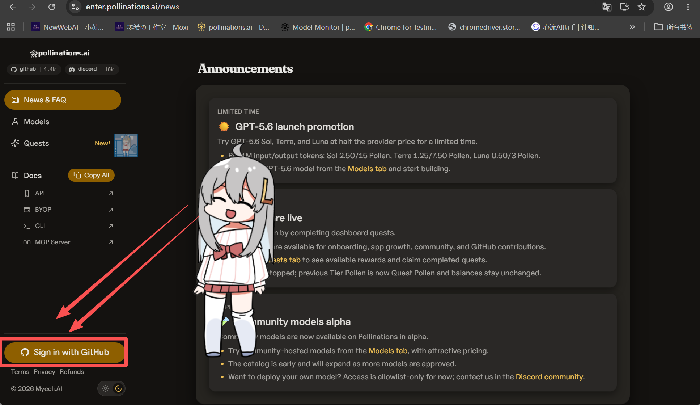
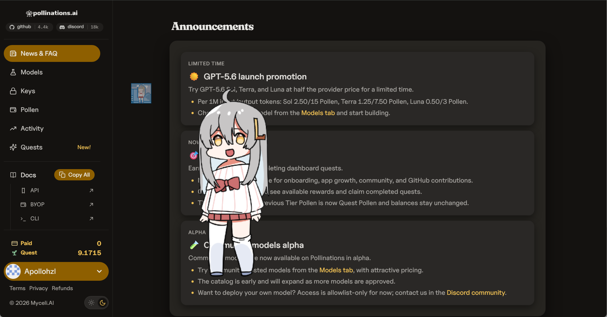
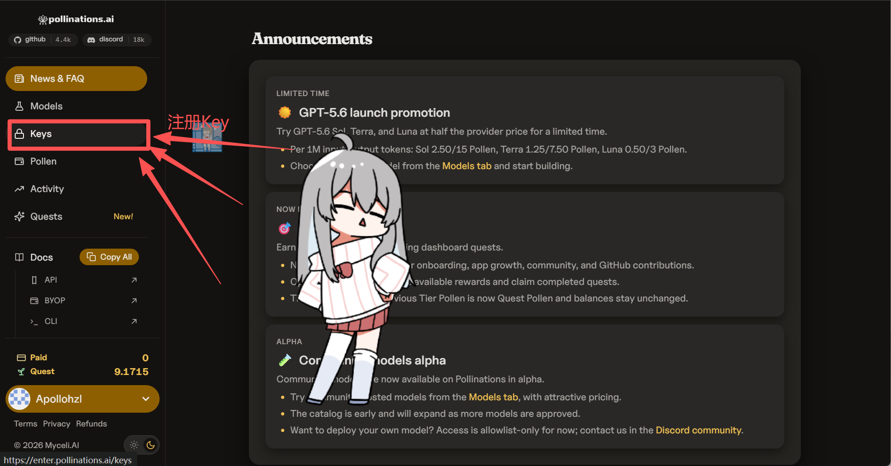
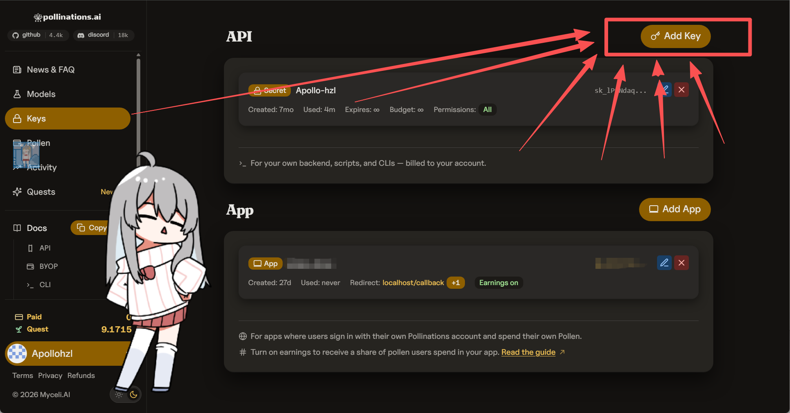
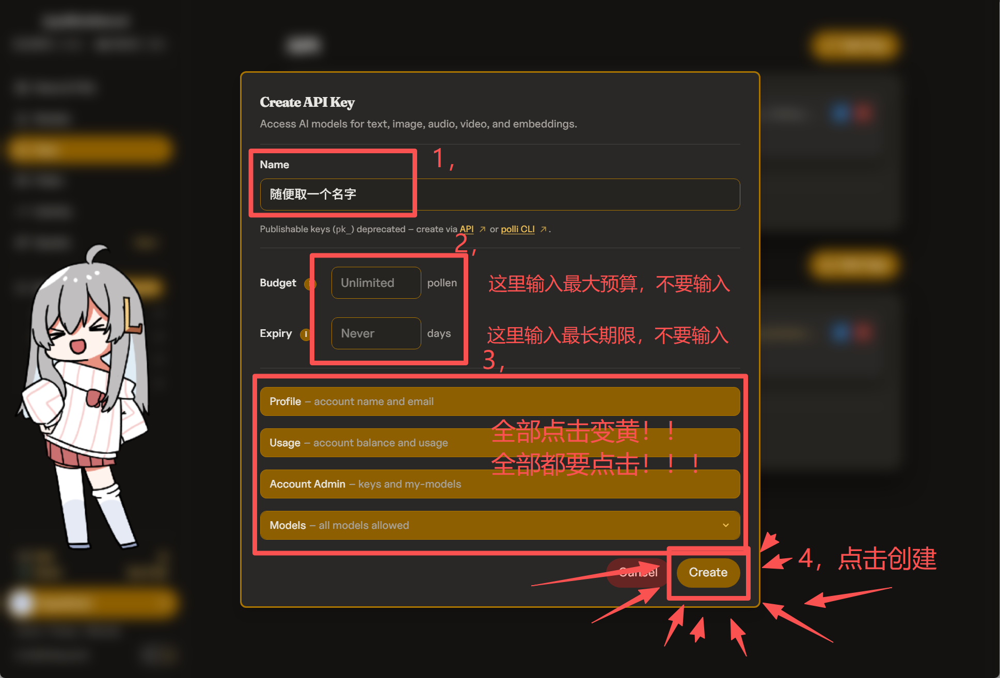
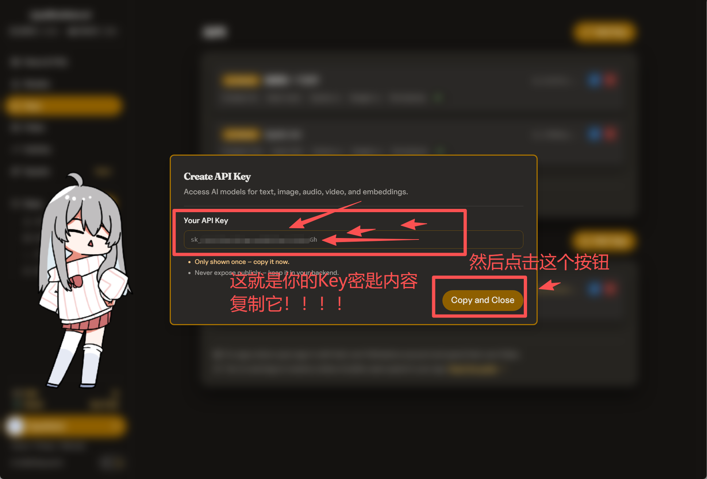
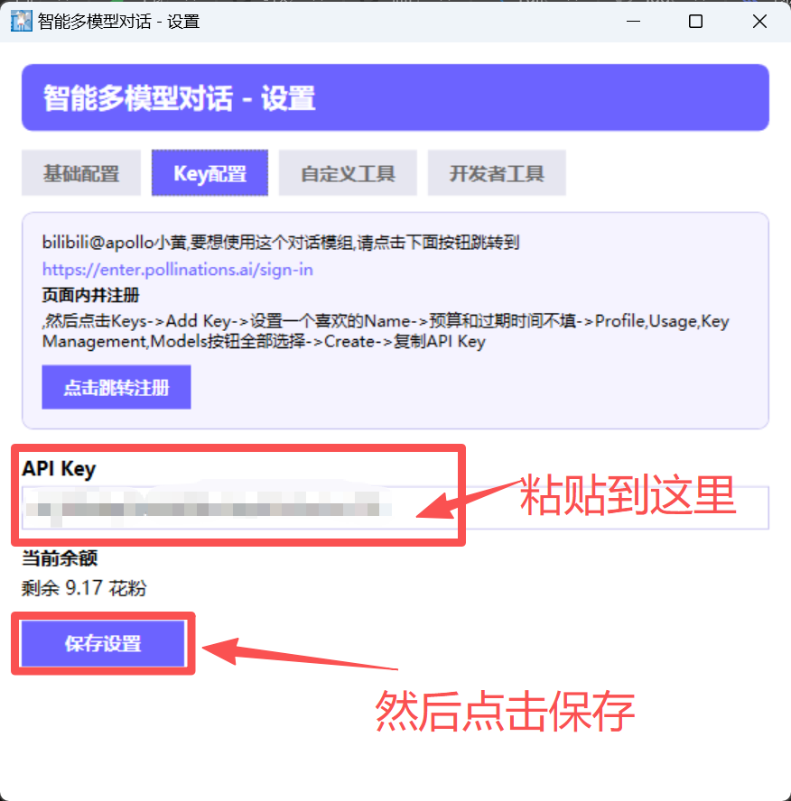
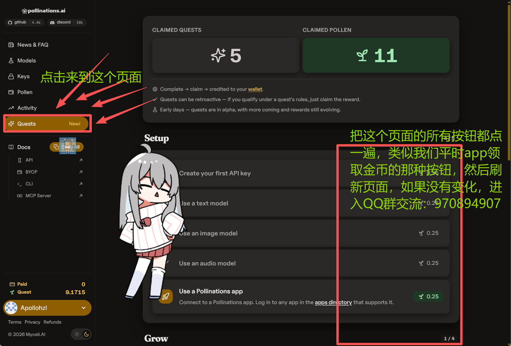

# 智能多模型语音对话操控（PetChat）

> 让你的桌宠不再只是看着你 —— 她能听懂你说话，能用多模型 AI 对话，还能帮你操作电脑。

[](https://www.bilibili.com/video/BV1g6NA63EuT/?share_source=copy_web&vd_source=07f60da640b7a6512d785b6f52f6358d)
[](https://steamcommunity.com/sharedfiles/filedetails/?id=3748857933)
[](https://qun.qq.com/universal-share/share?ac=1&authKey=t2uKIel1SRKya9c5gWLyOyxDGxzQ0RmPzdcUkb34G0j%2B7y50WxmrDbSj0sMONMV8&busi_data=eyJncm91cENvZGUiOiI5NzA4OTQ5MDciLCJ0b2tlbiI6InVpV01LSi91bnZpME0waDg3UHFtN3RubVg2OVVrMDExeTdSUkFyOWczd2FqcG4rNkxuOFFOQ3MzVjA1YjAxZ0kiLCJ1aW4iOiI5NTk4NTU1MzQifQ%3D%3D&data=YzF6DQ9YQv-XbAh9F2lWUDlybOnUMQ2ycuuQ6yQ0kTwvDPtTsKn-gxLQsvUJLvxGMoRQRI5oVYbbQinpLBAslw&svctype=4&tempid=h5_group_info)

---

## 📺 桌宠展示



---

## ✨ 功能特性

### 🎙️ 语音输入对话
- 基于 Vosk 离线语音识别，无需联网即可转文字
- 支持中文语音输入，说完自动发送对话
- 多种麦克风品质可选（普通/较好/很好/超级好）

### 🤖 多模型 AI 支持
- 对接 Pollinations 多模型 API
- 支持文本模型（GPT、Claude、Llama 等）
- 支持图片理解（多模态对话，拖拽图片即可分析）
- 模型列表动态加载，自动识别模型能力

### 🖼️ 文件拖拽上传
- 支持拖拽图片直接发送给 AI 分析
- 支持拖拽音频/视频文件，自动转文字
- 支持拖拽文档（TXT、PDF、Word、Excel 等）
- 文件自动上传转链接，嵌入对话上下文

### 🛠️ 丰富的内置工具
- **截图上传工具** — 一键截屏并上传分析
- **执行命令行** — AI 可调用系统命令（如 ffmpeg 转码等）
- **文件操作** — 读写本地文件、浏览目录
- **技能系统** — 支持自定义 .moxi 技能扩展

### 💾 对话历史
- 本地保存完整对话记录
- 支持多会话管理
- 对话历史可导出查看

### ⚙️ 高度可定制
- 自定义 System Prompt（系统提示词）
- 可配置 API 端点地址
- 灵活的日志管理

---

## 🚀 快速开始

### 1. 安装 Mod
1. 在 Steam 创意工坊中订阅 [智能多模型语音对话操控](https://steamcommunity.com/sharedfiles/filedetails/?id=3748857933)
2. 启动 VPet，在 Mod 列表中启用本插件
3. 右键桌宠 → 设置 → 找到「智能多模型对话」配置入口

### 2. 获取 API Key

#### Step 1：找到注册入口
打开 Mod 设置页面，点击 API Key 旁边的注册按钮跳转。



#### Step 2：登录账号
进入页面后点击登录按钮，推荐使用 GitHub 账号登录。



#### Step 3：登录成功
确认账号信息已正确显示。



#### Step 4：进入 Key 密匙管理
找到页面上的「Key 密匙」入口，点击进入管理页面。



#### Step 5：创建新的 Key
点击「创建新的 Key」按钮。



#### Step 6：配置 Key 参数
在弹出的配置页面中设置 Key 名称、最大预算、失效时间和可用功能。

> 💡 **提示**：初次使用保持默认即可，后续可根据需求调整。



#### Step 7：复制 API Key
配置完成点击确认后，页面会显示你的 API Key 密匙。**请立即复制并妥善保存！**

> ⚠️ **注意**：Key 只会显示一次，请务必复制保存。如果丢失，需要重新创建。



#### Step 8：在 Mod 中粘贴 Key
回到桌宠 Mod 设置页面，将复制的 Key 粘贴到 API Key 输入框中，点击保存。



#### Step 9：领取余额
配置完 Key 后，回到 Pollinations 网站的 Quests 页面，领取所有可用的余额奖励。

> 💡 余额每小时刷新，用完可以等待或完成任务获取更多额度。



### 3. 开始对话
配置完成后，右键桌宠 → 「智能对话」即可打开聊天窗口，开始和你的桌宠聊天啦！

---

## 📦 完整安装指南（含依赖下载）

> 💡 由于 GitHub 单文件大小限制，ffmpeg 和 Vosk 语音模型没有包含在仓库中。手动安装 Mod 时需要额外下载以下依赖。
>
> 如果你是通过 **Steam 创意工坊**订阅的，则无需手动下载，创意工坊会自动提供完整文件。

### 依赖一：FFmpeg（用于音视频处理）

FFmpeg 用于「执行命令行」工具中的音视频转码等功能。

**下载步骤：**
1. 前往 FFmpeg 官网下载：[https://ffmpeg.org/download.html](https://ffmpeg.org/download.html)
2. 下载 Windows 版本的 `ffmpeg-release-essentials.zip`
3. 解压后找到以下三个文件：
   - `ffmpeg.exe`
   - `ffplay.exe`
   - `ffprobe.exe`
4. 将这三个文件放到 Mod 目录下的 `plugin/ffmpeg/` 文件夹中

**目录结构：**
```
plugin/
  └── ffmpeg/
       ├── ffmpeg.exe
       ├── ffplay.exe
       └── ffprobe.exe
```

### 依赖二：Vosk 中文语音模型（用于语音输入）

Vosk 模型用于离线语音识别，实现语音对话功能。

**下载步骤：**
1. 前往 Vosk 官网下载中文模型：[https://alphacephei.com/vosk/models](https://alphacephei.com/vosk/models)
2. 下载 `vosk-model-small-cn-0.22` 或 `vosk-model-cn-0.22`（推荐小模型，体积小且识别速度快）
3. 解压整个文件夹
4. 将解压后的文件夹重命名为 `vosk-model-cn-0.22`
5. 放到 Mod 目录下的 `plugin/` 文件夹中

**目录结构：**
```
plugin/
  └── vosk-model-cn-0.22/
       ├── am/
       ├── conf/
       ├── graph/
       ├── ivector/
       └── README
```

### 验证安装

完成以上步骤后，Mod 目录结构应该如下：

```
PetChat/
  ├── img/
  ├── lang/
  ├── plugin/
  │    ├── ffmpeg/
  │    │    ├── ffmpeg.exe
  │    │    ├── ffplay.exe
  │    │    └── ffprobe.exe
  │    ├── vosk-model-cn-0.22/
  │    │    ├── am/
  │    │    ├── conf/
  │    │    ├── graph/
  │    │    └── ivector/
  │    ├── VPet.Plugin.PetChat.dll
  │    └── ... (其他 dll 文件)
  ├── src/
  ├── icon.png
  ├── info.lps
  └── README.md
```

启动 VPet 后，如果语音功能可以正常使用，说明安装成功了喵~

---

## 📖 使用说明

### 语音对话
1. 打开聊天窗口
2. 点击麦克风按钮开始说话
3. 说完后自动识别并发送对话
4. AI 回复会在对话框中流式显示

### 图片理解
- **方式一**：直接拖拽图片到聊天窗口
- **方式二**：点击截图按钮，截取当前屏幕

AI 会自动分析图片内容并回复。

### 使用工具
在对话中直接告诉 AI 你想做什么，例如：
- "帮我截取屏幕并分析一下"
- "用 ffmpeg 把这个视频转成 MP3"
- "读取一下 D 盘的那个 txt 文件"

AI 会自动调用相应工具完成任务。

---

## 🔧 配置项说明

| 配置项 | 说明 | 默认值 |
|--------|------|--------|
| API Key | Pollinations API 密钥 | （空） |
| 选择模型 | 当前使用的 AI 模型 | 自动选择 |
| 系统提示词 | AI 的人格设定和行为约束 | 默认桌宠设定 |
| 麦克风品质 | 语音识别精度 | 普通 |
| 日志目录 | 对话和运行日志保存位置 | 插件目录/logs |

---

## 🆘 常见问题

### Q：提示"余额不足"怎么办？
A：前往 Pollinations 网站的 Quests 页面领取免费额度，或等待每小时刷新。

### Q：语音识别没反应？
A：检查麦克风是否正常工作，在设置中选择正确的麦克风设备。

### Q：图片上传失败？
A：确认 API Key 正确且有余额，检查网络连接。

### Q：如何反馈 Bug 或提建议？
A：加入 QQ 群 **970894907** 反馈，或在 Steam 创意工坊留言。

---

## 💖 支持作者

这个 Mod 由一位初中生独立开发，你的支持是他继续更新的最大动力！

- 🌟 **给 Steam 创意工坊点赞**：[点我前往](https://steamcommunity.com/sharedfiles/filedetails/?id=3748857933)
- 🎬 **B 站视频三连**：[初中生2个月用AI做了个互动桌宠？！](https://www.bilibili.com/video/BV1g6NA63EuT/?share_source=copy_web&vd_source=07f60da640b7a6512d785b6f52f6358d)
- 💬 **加入 QQ 群**：[970894907](https://qun.qq.com/universal-share/share?ac=1&authKey=t2uKIel1SRKya9c5gWLyOyxDGxzQ0RmPzdcUkb34G0j%2B7y50WxmrDbSj0sMONMV8&busi_data=eyJncm91cENvZGUiOiI5NzA4OTQ5MDciLCJ0b2tlbiI6InVpV01LSi91bnZpME0waDg3UHFtN3RubVg2OVVrMDExeTdSUkFyOWczd2FqcG4rNkxuOFFOQ3MzVjA1YjAxZ0kiLCJ1aW4iOiI5NTk4NTU1MzQifQ%3D%3D&data=YzF6DQ9YQv-XbAh9F2lWUDlybOnUMQ2ycuuQ6yQ0kTwvDPtTsKn-gxLQsvUJLvxGMoRQRI5oVYbbQinpLBAslw&svctype=4&tempid=h5_group_info)

---

## 📝 更新日志

### v5.0.0
- 🎙️ 新增语音输入功能（Vosk 离线识别）
- 🖼️ 支持图片拖拽上传与多模态对话
- 🔧 完善工具调用系统
- ⚡ 优化对话流式输出
- 🐛 修复若干 Bug

---

## 📄 开源协议

本项目仅供学习交流使用。
